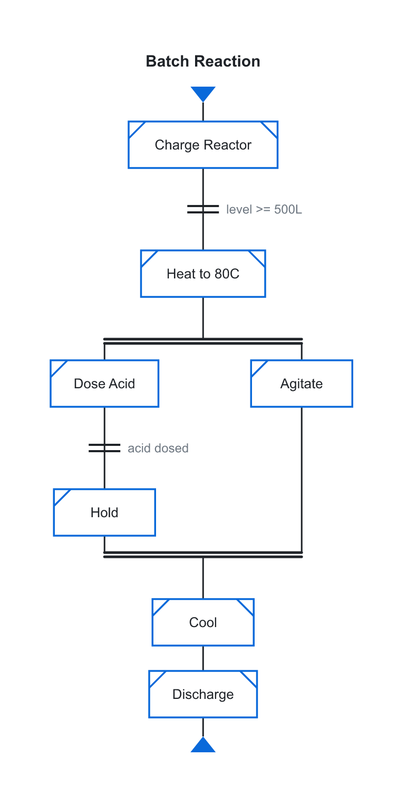

# PFC Charts

ISA-88 / IEC 61512 **Procedure Function Charts** from a small text DSL, rendered to
themed SVG. One framework-agnostic core drives multiple targets.

<p align="center">
  
</p>

That chart is the entire output of this text (drop it in a ` ```pfc ` fenced block):

```pfc
pfc Batch Reaction
step "Charge Reactor" :operation
trans "level >= 500L"
step "Heat to 80C" :operation
parallel
  branch
    step "Dose Acid" :phase
    trans "acid dosed"
    step "Hold" :phase
  branch
    step "Agitate" :phase
end
step "Cool" :operation
step "Discharge" :operation
```

## Repository layout

```
pfc-source/
  core/        shared engine — parser, layout, SVG renderer (package @pfc/core)
  obsidian/    Obsidian plugin adapter (consumes @pfc/core)
  vscode/      VS Code Markdown-preview extension (consumes @pfc/core)
  fumadocs/    Fumadocs (Next.js + MDX) adapter (consumes @pfc/core)
pfc-skills/    AI authoring skill (SKILL.md + examples) for writing pfc charts
output/        generated build artifacts (git-ignored, safe to delete)
build.mjs      build orchestrator -> output/<target>
```

`core/`, `obsidian/`, `vscode/`, and `fumadocs/` are npm workspaces; the
adapters import the shared engine as `@pfc/core`.

## Commands

Run from the repository root:

```bash
npm install
npm run build            # type-check + build every target -> output/
npm run build:obsidian   # build only the Obsidian target
npm run build:vscode     # build only the VS Code target
npm run build:fumadocs   # build only the Fumadocs target
npm run pack:fumadocs    # build + pack the Fumadocs adapter -> output/pfc-fumadocs-<v>.tgz
npm run dev              # watch-rebuild the Obsidian target
npm test                 # parser/layout unit tests
npm run lint             # eslint
npm run format           # prettier --write
```

## Targets

- **Obsidian** — built to `output/obsidian/` (`main.js`, `manifest.json`, `styles.css`).
  See [pfc-source/obsidian/README.md](pfc-source/obsidian/README.md) for install/usage
  and [pfc-source/obsidian/DOCUMENTATION.md](pfc-source/obsidian/DOCUMENTATION.md) for the
  full DSL reference.
- **VS Code** — a Markdown-preview extension built to `output/vscode/`. Renders `pfc`
  fenced blocks as inline SVG in the built-in preview. See
  [pfc-source/vscode/README.md](pfc-source/vscode/README.md).
- **Fumadocs** — a Next.js + MDX adapter (`@pfc/fumadocs`) built to `output/fumadocs/`.
  A React Server Component + optional remark plugin render `pfc` fences as static inline
  SVG (no client JS). See [pfc-source/fumadocs/README.md](pfc-source/fumadocs/README.md).

## Releasing a new version

Each target versions independently; there is one version source of truth per target.
Bump it, rebuild, then ship using the per-target step below.

### Obsidian

1. Bump `version` in [pfc-source/obsidian/manifest.json](pfc-source/obsidian/manifest.json)
   (and `minAppVersion` if it changed).
2. Add a `"<version>": "<minAppVersion>"` entry to
   [pfc-source/obsidian/versions.json](pfc-source/obsidian/versions.json).
3. `npm run build:obsidian` — ship the three files in `output/obsidian/`
   (`main.js`, `manifest.json`, `styles.css`) via a GitHub release tagged with the exact
   version, or copy them into `<vault>/.obsidian/plugins/pfc-charts/`.

### VS Code

1. Bump `version` in [pfc-source/vscode/package.json](pfc-source/vscode/package.json) and
   add a matching entry to [pfc-source/vscode/CHANGELOG.md](pfc-source/vscode/CHANGELOG.md).
   Bump it by hand: `vsce publish patch|minor|major` would only bump the build copy in
   `output/vscode/`, which the next build overwrites.
2. `npm run build:vscode`.
3. Package from `output/vscode/` (`--no-dependencies`: the extension is fully bundled into
   `dist/extension.js`):
   ```bash
   cd output/vscode
   npx @vscode/vsce package --no-dependencies   # -> pfc-charts-<v>.vsix
   ```
4. Publish by uploading the `.vsix` at <https://marketplace.visualstudio.com/manage>
   (publisher `acro`): **New extension → Visual Studio Code** the first time, then
   **Update** from the extension's **More actions** menu for later versions. Installed
   copies update automatically. A version number can never be reused.

   Command-line alternative: `vsce login acro`, then
   `npx @vscode/vsce publish --no-dependencies`. That needs an Azure DevOps PAT
   (organization **All accessible organizations**, scope **Marketplace › Manage**). Such
   global PATs are retired on December 1, 2026; after that, command-line publishing needs
   Microsoft Entra ID (`vsce publish --azure-credential`).

### Fumadocs

1. Bump `version` in [pfc-source/fumadocs/package.json](pfc-source/fumadocs/package.json)
   (the build reads it into the packaged manifest).
2. `npm run pack:fumadocs` — builds and packs to
   `output/pfc-fumadocs-<version>.tgz`.
3. In the docs app, install the new tarball
   (`npm install <path>/output/pfc-fumadocs-<version>.tgz`) and restart the dev server.
